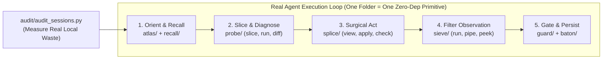

# Anti-Obsolescence Design Architecture: Building Agent Infrastructure That Survives Model Upgrades

[English](./DESIGN.md) | [简体中文](./DESIGN.zh-CN.md)

## 1. Why 95% of Agent Repositories Become Obsolete Within 6 Months

Every frontier model generation (`GPT-5 → GPT-6`, `Grok-4 → Grok-5`, `Claude-4 → Claude-5`, `Gemini-3 → Gemini-4`) internalizes what used to require external scaffolding:

- **Prompt Roleplay & Workflow Templates Die First**: Checklists ("think step-by-step", "act as planner/reviewer") get absorbed directly into RL post-training weights and official CLI slash commands.
- **Heavy Orchestration Frameworks Die Second**: Official CLIs (`codex`, `grok`, `claude`, `agy`, `openclaw`) natively own the conversation loop, subagent spawning, and tool scheduler. Competing with the host runtime creates lock-in and breakage.
- **Lossy RAG / Vector Wrappers Die Third**: Expanding context windows and faster prefill erase approximate vector-chunk retrieval while exposing its setup burden (Docker, API keys, stale indexes).

**Core Thesis**: To build infrastructure that **cannot be replaced by a smarter model—and actually becomes *more* valuable as models get stronger**—we must never build "thinking crutches." Instead, we must build **deterministic Unix-style OS/AST/Heap/Byte primitives** at the **four physical boundaries where autoregressive token generation is mathematically mismatched with reality**.

---

## 2. The Four Irreducible Physical Boundaries of Any LLM Agent

No matter how high an LLM's reasoning IQ rises, a Transformer processes discrete tokens in an append-only KV-cache, whereas software and personal data live in OS processes, mutable memory heaps, byte-encoded files, and ephemeral sessions:

| Physical Boundary | Why Scaling Model Weights Alone Cannot Eliminate It | Measured Real-World Waste Across `Grok`, `Codex`, `Antigravity` & `Claude` | Our Deterministic Primitive |
| :--- | :--- | :--- | :--- |
| **1. External Entropy vs. `O(N)` KV-Cache Physics** | Dumping 50 KB of noisy CI logs, JSON API dumps, or 20 unreferenced dead modules into context physically inflates prefill latency, dilutes attention, and bills every subsequent turn's cache read. | **16.8%** of Codex tool outputs exceed `8 KB`; **169** truncation spills in Antigravity; `818k` cached tokens burned in a single Grok bug-fix session. | **`sieve/`** (Lossless FTS5 output firewall) + **`atlas/`** (Zero-read structural map) + **`probe/ slice`** (Static call-graph pruning) |
| **2. Prose Simulation vs. Concrete Heap & Type Execution** | Guessing pointer aliasing, shallow-copy dict sharing, void state-rollback no-ops, or `bool`/`int`/`None` edge cases in natural language prose is slow and error-prone—while hand-writing inline `python -c` probes hits shell-quoting and `sys.path` crashes. | **55,398** reasoning tokens (`19.1 min`) burned by `grok-4.7` on 1 heap-aliasing bug; **966** ad-hoc `python -c` probes across Codex & Antigravity causing **100** `ImportError`s and **54** shell-quoting crashes. | **`probe/`** (`run --stdin` `sys.settrace` heap/mutation/noop microscope + `diff` boundary/cache oracle) |
| **3. Token-Stream Generation vs. Byte/AST-Exact File Transactions** | Models emit BPE tokens, not raw bytes (`\r\n` vs `\n`, UTF-8 vs `cp936`, AST spans, `.pyc` mtimes). Line shifts after an edit force repeated full-file re-reads or cause silent `str.replace()` 0-ops. | **50.1%** (`660 / 1,318`) of Antigravity `read_file` calls re-read the exact same file; **4,835** manual line-slice shell calls, **231** patch mismatches, and **155** Windows UTF-8/CP936 crashes in Codex. | **`splice/`** (`view` AST symbol / Markdown section + `apply` UTF-8/CRLF-safe syntax-verified atomic rollback patcher) |
| **4. Session Compaction & Self-Report Bias** | Context compaction (`/compact`) erases negative constraints ("what already failed"), and autoregressive logits cannot prove tests actually ran *after* the last file write. | Repeated identical failing commands, post-compaction regression loops, and monolithic `AGENTS.md` bloat. | **`baton/`** (Compaction state capsule) + **`guard/`** (`exit 2` loop & stop-truth gate) + **`recall/`** (`<4ms` SQLite FTS5 + CJK memory) |

---

## 3. Repository Blueprint: Mapped 1-to-1 to the Real Agent Execution Loop

Rather than an unstructured collection of scripts, `agent-primitives` is organized around **1 Local Telemetry Auditor (`audit/`) + 7 Independent Single-Folder Primitives (`skills/*/`)** covering the exact 5 stages of every Coding Agent and Personal Assistant Agent turn:

---

## 4. The Four Strict Admission Laws (How We Keep This Repo High-Signal Forever)

Every folder in `skills/` must pass four non-negotiable engineering gates:

1. **Deterministic Computation Over Prompt Prose**: Must execute real AST, `sys.settrace`, SQLite FTS5/BM25, cryptographic hash/mtime, or ACID byte transactions that an LLM cannot reliably hallucinate in weights. Zero pure-prompt "persona" folders.
2. **One Folder = Complete Standalone Infrastructure**: `cp -r skills/probe ~/.agents/skills/` must work in isolation with **Python 3.9+ standard library only** (`0` pip packages, `0` daemons, `0` API keys) on Linux, macOS, and Windows.
3. **Strict Context & Latency Budget**: Idle frontmatter cost must stay **`< 85 tokens`**, CLI execution latency **`< 100 ms`**, and output size bounded (`< 1,000 tokens`) with lossless drill-down.
4. **Telemetry-Backed A/B Proof**: Every primitive must correspond to a measurable failure mode observed in real CLI trajectories (`audit/audit_sessions.py`) and demonstrate real token/latency/reliability gains on live CLI runs (`grok`, `codex`, `agy`, `claude`).
