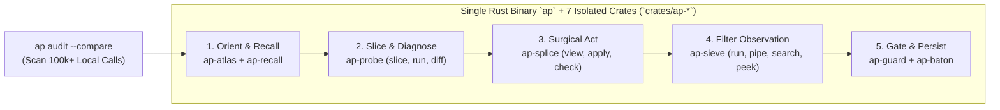

# Anti-Obsolescence Design Architecture: Building Agent Infrastructure That Survives Model Upgrades

[English](./DESIGN.md) | [简体中文](./DESIGN.zh-CN.md)

## 1. Why 95% of Agent Repositories Become Obsolete Within 6 Months

Every frontier model generation (`GPT-5 → GPT-6`, `Grok-4 → Grok-5`, `Claude-4 → Claude-5`, `Gemini-3 → Gemini-4`) internalizes what used to require external scaffolding:

- **Prompt Roleplay & Workflow Templates Die First**: Checklists ("think step-by-step", "act as planner/reviewer") get absorbed directly into RL post-training weights and official CLI slash commands.
- **Heavy Orchestration Frameworks Die Second**: Official CLIs (`codex`, `grok`, `claude`, `agy`, `pi`, `openclaw`) natively own the conversation loop, subagent spawning, and tool scheduler. Competing with the host runtime creates lock-in and breakage.
- **Lossy RAG / Vector Wrappers Die Third**: Expanding context windows and faster prefill erase approximate vector-chunk retrieval while exposing its setup burden (Docker, API keys, stale indexes).

**Core Thesis**: To build infrastructure that **cannot be replaced by a smarter model—and actually becomes *more* valuable as models get stronger**—we must never build "thinking crutches." Instead, we build a **single self-contained Rust native binary (`ap` / `ap.exe`)** providing **deterministic Unix-style OS / Tree-sitter AST / Heap / Bundled SQLite primitives** at the **four physical boundaries where autoregressive token generation is mathematically mismatched with reality**.

---

## 2. The Four Irreducible Physical Boundaries of Any LLM Agent

No matter how high an LLM's reasoning IQ rises, a Transformer processes discrete tokens in an append-only KV-cache, whereas software and personal data live in OS processes, mutable memory heaps, byte-encoded files, and ephemeral sessions:

| Physical Boundary | Why Scaling Model Weights Alone Cannot Eliminate It | Measured Real-World Waste Across `Grok`, `Codex`, `Antigravity`, `Pi` & `Claude` (`101k+` Calls) | Our Deterministic Rust Crate & Skill |
| :--- | :--- | :--- | :--- |
| **1. External Entropy vs. `O(N)` KV-Cache Physics** | Dumping 50 KB of noisy CI logs, JSONL streams, or 20 unreferenced dead modules into context physically inflates prefill latency, dilutes attention, and bills every subsequent turn's cache read. | **30,274** tool outputs `>8 KB`; **190** truncation spills; `818k` cached tokens burned in a single Grok bug-fix session. | **`ap-sieve`** (Lossless bundled SQLite FTS5 output firewall) + **`ap-atlas`** (`16ms` Tree-sitter map) + **`ap-probe` `slice`** (`7ms` reachability pruning) |
| **2. Prose Simulation vs. Concrete Heap & Type Execution** | Guessing pointer aliasing, shallow-copy dict sharing, void state-rollback no-ops, `-0`/`NaN`, or integer rounding edge cases in natural language prose is slow and error-prone—while ad-hoc `python -c`/`node -e` probes hit shell-quoting crashes. | **55,398** reasoning tokens (`19.1 min`) burned by `grok-4.7` on 1 heap-aliasing bug; **4,604** inline probes causing **185** `ImportError`s and **131** shell-quoting crashes. | **`ap-probe`** (`run` heap/mutation/noop/`-0` microscope + `diff` boundary/cache oracle across Py, TS/JS & Rust) |
| **3. Token-Stream Generation vs. Byte/AST-Exact File Transactions** | Models emit BPE tokens, not raw bytes (`\r\n` vs `\n`, UTF-8 validity, Tree-sitter AST syntax across languages). Line shifts after edits force repeated full-file re-reads or cause broken syntax writes. | **904** redundant same-file re-reads, **14,782** shell line-slice reads, **735** patch mismatches, and **392** UTF-8/encoding crashes. | **`ap-splice`** (`0.8ms` Tree-sitter AST `view` + `3.1ms` zero-escaping atomic rollback `apply --stdin --test` across Py/TS/JS/Go/Rust/C) |
| **4. Session Compaction & Self-Report Bias** | Context compaction (`/compact`) erases negative constraints ("what already failed"), and autoregressive logits cannot prove tests actually ran *after* the last file write. | **237** identical retry loops, post-compaction regression loops, and monolithic `AGENTS.md` bloat. | **`ap-baton`** (Compaction state capsule) + **`ap-guard`** (`<2ms` `exit 2` shield & loop gate) + **`ap-recall`** (`3.3ms` bundled SQLite FTS5 + CJK vault) |

---

## 3. Why Pure Rust (`v1.0`) Over C or Python?

1. **Memory & Type Safety Without GC (`Rust > C`)**: Compile-time ownership, borrow checking, strict UTF-8 `str` invariants, linear-time `O(n)` regexes (zero ReDoS), and explicit `Result<T, E>` handling eliminate dangling pointers, buffer overflows, and silent undefined behavior while keeping C-level `<2ms` native binary startup.
2. **Zero Host Runtime Fragility (`Rust > Python`)**: Eliminates Python interpreter cold-start overhead (`35–65ms` per hook call on Windows), missing `python3` PATH issues, `cp936` console crashes, and host SQLite builds lacking FTS5.
3. **Compiled-In Tree-sitter + Bundled SQLite FTS5**: Six official Tree-sitter C grammars (`Python`, `TypeScript/TSX`, `JavaScript`, `Go`, `Rust`, `C`), `ripgrep`'s `ignore` walker, and SQLite 3 (`FTS5` + `BM25`) compile into **one self-contained binary (`ap` / `ap.exe`)** alongside all 7 embedded `SKILL.md` definitions.

---

## 4. The Four Strict Admission Laws

1. **Deterministic Computation Over Prompt Prose**: Must execute real Tree-sitter AST, heap/proxy tracing, bundled SQLite FTS5/BM25, cryptographic hash/mtime, or ACID byte transactions. Zero pure-prompt folders.
2. **Crate-Level Physical Isolation + Zero Runtime Dependencies**: Every `crates/ap-<name>/` crate compiles standalone with **zero sibling `ap-*` dependencies** (`cargo clippy --workspace -- -D warnings`), and the prebuilt `ap` binary runs on Linux (`musl`), macOS, and Windows with `0` Python/Node/Docker requirements.
3. **Strict Context & Latency Budget**: Idle frontmatter cost stays **`< 85 tokens`** (`57–61 tokens` measured), core CLI latency **`< 50 ms`**, and output size bounded (`< 1,000 tokens`).
4. **Telemetry-Backed A/B Proof**: Every primitive corresponds to a measurable failure mode in `ap audit` and proves real latency/token/reliability gains on live CLI runs (`Grok`, `Codex`, `Antigravity`, `Pi`).
