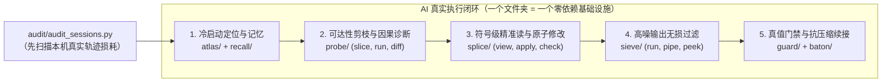

# 抗淘汰架构设计准则：如何基于 AI 真实执行过程打造不被模型迭代替代的基础设施

[English](./DESIGN.md) | [简体中文](./DESIGN.zh-CN.md)

## 1. 为什么 GitHub 上 95% 的 Agent 项目会在半年内过时？

每一次前沿基座模型迭代（`GPT-5 → GPT-6`、`Grok-4 → Grok-5`、`Claude-4 → Claude-5`、`Gemini-3 → Gemini-4`）以及官方 CLI 更新，都会迅速吞噬三类伪基础设施：

- **第一批死掉的是「提示词套路与角色扮演模板」**：所谓「分步思考模板」「规划师/审查员 Prompt 清单」会在下一代 RL 后训练中直接内化进模型权重，或变成官方内置斜杠命令。
- **第二批死掉的是「重型多智能体编排框架」**：`codex`、`grok`、`claude`、`agy`、`openclaw` 等宿主天然掌控主循环、工具并发与子智能体调度，重造外层框架只会带来高昂维护成本与版本断裂。
- **第三批死掉的是「有损向量检索与复杂外挂服务」**：依赖 Docker、向量库或外部 API Key 的重型插件部署门槛极高，且随上下文窗口扩大迅速贬值。

**核心判断**：真正**不怕短期内被 AI 升级替代、甚至模型越聪明越离不开**的基础设施，绝不能去教模型「怎么说话或怎么扮演角色」，而必须在**自回归 Token 生成机制与物理操作系统之间的四道刚性边界**上，提供类似 **Unix Coreutils（`git` / `strace` / `sqlite` / `diff`）** 的确定性底层原语。

---

## 2. 大模型无论怎么升级都跨不过去的四道物理边界

无论模型推理智商多高，Transformer 的本质依然是在追加式 KV-Cache 上逐 Token 采样，而真实代码与个人数据运行在操作系统进程、可变堆内存、字节流文件与随时压缩的会话中：

| 物理边界 | 为什么光靠模型参数升级无法消除 | 我们在 `Grok`、`Codex`、`Antigravity`、`Claude` 实测抓到的真实损耗 | 对应的确定性单文件夹原语 |
| :--- | :--- | :--- | :--- |
| **1. 外部环境高熵噪音 vs `O(N)` 上下文物理成本** | 几万行测试日志、大型 JSON/HTML 返回或几十个未引用旁路模块一旦灌入上下文，必然拉慢首字延迟、稀释注意力，并在后续每一轮重复计费。 | Codex 中 **16.8%** 的工具输出超 `8 KB`；Antigravity 出现 **169 次**超长截断溢出；Grok 单次排障累计重读 `81.8 万` 缓存 Tokens。 | **`sieve/`**（无损 FTS5 输出防火墙）+ **`atlas/`**（零读结构地图）+ **`probe/ slice`**（静态调用图可达性剪枝） |
| **2. 自然语言脑内推演 vs 真实堆内存/类型执行语义** | 靠自然语言在脑中模拟浅拷贝嵌套引用共享、原地改入参、状态字典键失配或 `bool`/`int`/`None` 边界极慢且易自相矛盾；手写临时 `python -c` 又频发引号转义与路径报错。 | `grok-4.7` 在单题上空转消耗 **55,398 Reasoning Tokens（19.1 分钟）**；Codex 与 Antigravity 累计手写 **966 次**临时 `python -c` 探针，引发 **100 次** `ImportError` 与 **54 次**命令行引号语法崩溃。 | **`probe/`**（`run --stdin` 免转义运行时别名/篡改/空操作显微镜 + `diff` 边界与缓存差分探针） |
| **3. BPE Token 序列生成 vs 字节级/AST 级原子文件修改** | 模型输出的是 Token 而非原始字节（`\r\n` vs `\n`、UTF-8 vs Windows `cp936`、AST 起止行、过期 `.pyc`）。上方代码改动引发的行号漂移迫使模型反复重读整份文件。 | Antigravity 中 **50.1%**（`660 / 1,318`）的 `read_file` 在重复读同一文件；Codex 出现 **4,835 次**手工切行号、**231 次**补丁失配与 **155 次** Windows 编码崩溃。 | **`splice/`**（`view` AST 符号/Markdown 章节精准读取 + `apply` 强制 UTF-8/保留 CRLF/语法预检原子回滚补丁器） |
| **4. 会话压缩失忆 vs 完成态自证偏见** | 上下文压缩（`/compact`）会抹掉已证伪死胡同；模型无法靠自身概率输出证明「最后一次改完文件后测试确实跑通」。 | 同一报错命令死循环重试、跨会话踩重复坑、`AGENTS.md` 越塞越肿导致指令遵循率下降。 | **`baton/`**（抗压缩状态胶囊）+ **`guard/`**（`exit 2` 死循环熔断与停机真值门禁）+ **`recall/`**（`<4ms` 按需触发记忆库） |

---

## 3. 仓库架构设计：严格按 AI 真实执行闭环 1:1 映射

仓库不搞大而全框架，而是采用 **「1 个本地过程审计器（`audit/`） + 7 个正交独立单文件夹原语（`skills/*/`）」** 的微内核布局，完整覆盖 Coding Agent 与个人助手 Agent 的真实五步过程闭环：

**为什么这套设计自带传播力与长期生命力？**
任何开发者把仓库拉下来，先跑一行 `python audit/audit_sessions.py`（100% 本地扫描 `~/.codex`、`~/.claude`、`~/.grok`、`~/.gemini/antigravity-cli`，零联网、零隐私泄露），**2 秒内就能看到自己电脑上过去几十场会话到底浪费了多少次重复读文件、多少次 `python -c` 引号崩溃、多少次补丁失配与超长输出**，并按需只拷走他最痛的那 1～2 个文件夹。

---

## 4. 新能力准入的四条铁律（严防仓库退化为玩具集合）

未来任何进入 `skills/` 的文件夹，必须同时满足四条硬指标：

1. **必须是确定性计算原语，绝不收纯 Prompt 话术**：必须在 AST、运行时堆追踪（`sys.settrace`）、SQLite FTS5/BM25、哈希状态机或 ACID 文件字节事务上完成大模型权重无法可靠完成的确定性工作。
2. **单文件夹彻底自治、零第三方依赖**：随便单独拷走一个目录（`cp -r skills/probe ~/.agents/skills/`），仅凭系统自带 Python 3.9+ 标准库即可在 Windows / macOS / Linux 直接运行，无需 `pip install`、无需常驻进程、无需 API Key。
3. **极低待机税与毫秒级延迟**：每个模块待机 YAML 头严格 **`< 85 tokens`**，本地执行延迟 **`< 100 ms`**，单次输出严格收敛在 **`< 1,000 tokens`**。
4. **必须经过真实 CLI 轨迹审计与实机 A/B 验证**：必须对应 `audit_sessions.py` 在真实轨迹中统计出的高频损耗，并在本地真实 CLI（`grok` / `codex` / `agy` / `claude`）上跑出可复核的耗时、Token 或准确率提升。
