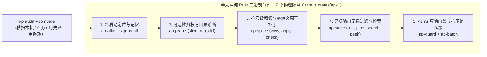

# 抗淘汰架构设计准则：为什么用纯 Rust 打造不被大模型换代替代的底层基础设施

[English](./DESIGN.md) | [简体中文](./DESIGN.zh-CN.md)

## 1. 为什么 GitHub 上 95% 的 Agent 项目会在半年内过时？

每一次前沿基座模型迭代（`GPT-5 → GPT-6`、`Grok-4 → Grok-5`、`Claude-4 → Claude-5`、`Gemini-3 → Gemini-4`）以及官方 CLI 更新，都会迅速吞噬三类伪基础设施：

- **第一批死掉的是「提示词套路与角色扮演模板」**：所谓「分步思考模板」「规划师/审查员 Prompt 清单」会在下一代 RL 后训练中直接内化进模型权重，或变成官方内置斜杠命令。
- **第二批死掉的是「重型多智能体编排框架」**：`codex`、`grok`、`claude`、`agy`、`pi`、`openclaw` 等宿主天然掌控主循环、工具并发与子智能体调度，重造外层框架只会带来高昂维护成本与版本断裂。
- **第三批死掉的是「有损向量检索与复杂外挂服务」**：依赖 Docker、向量库或外部 API Key 的重型插件部署门槛极高，且随上下文窗口扩大迅速贬值。

**核心判断**：真正**不怕短期内被 AI 升级替代、甚至模型越聪明越离不开**的基础设施，绝不能去教模型「怎么说话或怎么扮演角色」，而必须在**自回归 Token 生成机制与物理操作系统之间的四道刚性边界**上，用**单文件纯 Rust 原生二进制（`ap` / `ap.exe`）**提供类似 **Unix Coreutils（`git` / `ripgrep` / `sqlite` / `strace`）** 的确定性底层原语。

---

## 2. 大模型无论怎么升级都跨不过去的四道物理边界

无论模型推理智商多高，Transformer 的本质依然是在追加式 KV-Cache 上逐 Token 采样，而真实代码与个人数据运行在操作系统进程、可变堆内存、字节流文件与随时压缩的会话中：

| 物理边界 | 为什么光靠模型参数升级无法消除 | 我们在本机 5 大 CLI（`10.1 万+` 次调用）抓到的真实损耗 | 对应的确定性 Rust Crate 原语 |
| :--- | :--- | :--- | :--- |
| **1. 外部环境高熵噪音 vs `O(N)` 上下文物理成本** | 几万行测试日志、JSONL 流、复杂 HTML 或几十个死代码模块一旦灌入上下文，必然拉慢首字延迟、稀释注意力，并在后续每一轮重复计费。 | **30,274 次**工具输出超 `8 KB`；**190 次**超长截断溢出；Grok 单次排障累计重读 `81.8 万` 缓存 Tokens。 | **`ap-sieve`**（内置 SQLite FTS5 输出防火墙）+ **`ap-atlas`**（`16ms` Tree-sitter 结构图）+ **`ap-probe` `slice`**（`7ms` 可达性剪枝） |
| **2. 自然语言脑内推演 vs 真实堆内存/类型执行语义** | 靠自然语言在脑中模拟浅拷贝嵌套引用共享、异常未回滚半途修改、`-0`/`NaN` 或整数舍入边界极慢且易出错；手写 `python -c`/`node -e` 又频发引号崩溃。 | `grok-4.7` 在单题上空转消耗 **55,398 Reasoning Tokens（19.1 分钟）**；累计 **4,604 次**临时内联探针引发 **185 次** `ImportError` 与 **131 次**引号语法崩溃。 | **`ap-probe`**（`run` 堆别名/原地篡改/空操作/`-0` 显微镜 + `diff` 跨 Py/TS/JS/Rust 边界与缓存差分探针） |
| **3. BPE Token 序列生成 vs 字节级/AST 级原子文件修改** | 模型输出的是 Token 而非原始字节（`\r\n` vs `\n`、严格 UTF-8、多语言语法树合法性）。行号漂移迫使模型反复重读整份文件或写入残缺语法。 | **904 次**同文件重复重读、**14,782 次**手工切行号、**735 次**补丁失配与 **392 次** UTF-8/编码崩溃。 | **`ap-splice`**（`0.8ms` 6 语言 Tree-sitter 符号精读 + `3.1ms` 零转义 AST 语法预检原子回滚补丁器） |
| **4. 会话压缩失忆 vs 完成态自证偏见** | 上下文压缩（`/compact`）会抹掉已证伪死胡同；模型无法靠自身概率输出证明「最后一次改完文件后测试确实跑通」。 | **237 次**相同报错死循环重试、跨会话踩重复坑、`AGENTS.md` 越塞越肿导致遵循率下降。 | **`ap-baton`**（抗压缩状态胶囊）+ **`ap-guard`**（`<2ms` `exit 2` 死循环熔断与双协议护盾）+ **`ap-recall`**（`3.3ms` FTS5 中英微记忆库） |

---

## 3. 为什么 `v1.0` 选择纯血 Rust（对比 C 与 Python）？

1. **超越 C 的编译期内存与类型可靠性**：同样具备原生机器码、`<2ms` 瞬时启动、零 GC 停顿，但 Rust 在编译期通过所有权与借用检查彻底根除悬垂指针、缓冲区溢出与数据竞争；内置严格 UTF-8 字符串不变量与线性时间 `O(n)` 正则引擎（免疫灾难性回溯 ReDoS），所有错误强制显式 `Result<T, E>` 闭环。
2. **彻底摆脱 Python 宿主运行时包袱**：消除 Windows 下 Python 冷启动每次 `35~65ms` 的 Hook 税、宿主未装 Python 或缺失 SQLite FTS5 模块、`cp936` 控制台编码崩溃与 `\\?\` 长路径兼容陷阱。
3. **单二进制内嵌 6 语言真 Tree-sitter AST + 静态 SQLite FTS5**：将 `Python`、`TypeScript/TSX`、`JavaScript`、`Go`、`Rust`、`C` 六套官方 Tree-sitter C 语法树、`ripgrep` 同款 `ignore` 引擎、静态编译 SQLite 3（`FTS5` + `BM25`）与全部 7 个 `SKILL.md` 编译进**唯一一个单文件可执行程序 `ap`（`ap.exe`）**，一行 `curl`/`irm` 秒级下载接入。

---

## 4. 新能力准入的四条铁律

1. **必须是确定性计算原语，绝不收纯 Prompt 话术**：必须在 Tree-sitter AST、运行时堆/代理追踪、内置 SQLite FTS5/BM25、哈希状态机或 ACID 文件字节事务上完成大模型权重无法可靠完成的确定性工作。
2. **Crate 级物理隔离 + 零外部运行时依赖**：`crates/ap-<name>/` 严禁互相依赖兄弟 Crate（由集成测试与 `cargo clippy -D warnings` 强制守护）；预编译单二进制在 Linux (`musl`)、macOS、Windows 开箱即跑，无需用户安装 Python、Rust、Node 或 Docker。
3. **极低待机税与毫秒级延迟**：每个模块待机 YAML 头严格 **`< 85 tokens`**（实测仅 `57~61 tokens`），核心操作本地延迟 **`< 50 ms`**（实测 `0.8~17 ms`）。
4. **必须经过真实 CLI 轨迹审计与实机 A/B 验证**：必须对应 `ap audit` 在真实轨迹中统计出的高频损耗，并在本地真实 CLI（`Grok`、`Codex`、`Antigravity`、`Pi`）上跑出可复核的硬指标提升。
