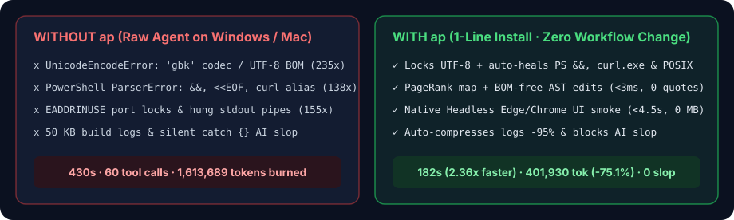

<div align="center">
  
  <h1>ap</h1>
  <p><strong>Make AI coding agents 2x faster &amp; zero-slop on Windows &amp; macOS — by solving where LLM <code>&lt;thinking&gt;</code> actually gets stuck.</strong></p>
  <p>
    <a href="https://github.com/xgbtxy/ap/actions/workflows/ci.yml"></a>
    <a href="https://github.com/xgbtxy/ap/releases/latest"></a>
    
    
    <a href="./LICENSE"></a>
  </p>
  <p>
    <strong>English</strong> · <a href="./README.zh-CN.md"><strong>简体中文</strong></a> · <a href="./docs/HANDBOOK.md">Core R&amp;D Philosophy</a> · <a href="https://github.com/xgbtxy/ap/releases/latest">Prebuilt Downloads</a>
  </p>
  
</div>

---

## Install in 10 Seconds, Then Forget About It

No `Python`, no `Node`, no `Playwright`, no `Docker`, and **zero new commands to memorize**. One line installs the native `ap` binary and automatically wires your coding agents (`Claude Code`, `Codex`, `OpenCode`, `Gemini CLI`, `Qwen Code`, `Pi`, `Goose`, `Antigravity`, `Grok`):

**Windows (PowerShell):**
```powershell
curl.exe -fsSL https://raw.githubusercontent.com/xgbtxy/ap/main/install.ps1 | iex
```

**macOS / Linux:**
```bash
curl -fsSL https://raw.githubusercontent.com/xgbtxy/ap/main/install.sh | sh
```

> **Prefer direct download?** Grab the standalone binary (**[Windows x64 `.zip`](https://github.com/xgbtxy/ap/releases/latest/download/ap-x86_64-pc-windows-msvc.zip)** · **[macOS Apple Silicon](https://github.com/xgbtxy/ap/releases/latest/download/ap-aarch64-apple-darwin.tar.gz)** · **[macOS Intel](https://github.com/xgbtxy/ap/releases/latest/download/ap-x86_64-apple-darwin.tar.gz)** · **[Linux x64](https://github.com/xgbtxy/ap/releases/latest/download/ap-x86_64-unknown-linux-musl.tar.gz)**) and run `ap init`. Remove cleanly anytime via `ap uninstall`.

---

## Why We Built `ap`: Fixing Where AI `<thinking>` Derails

Saving tokens is **not** the primary goal—it is a natural byproduct.

When we audited **101,108 real tool calls** and raw `<thinking>` traces across coding agents on Windows and macOS, we found that models rarely fail because they "lack intelligence." They get slow, confused, and write sloppy code because **4 real-world bottlenecks hijack their working memory**:

| Where AI `<thinking>` Gets Stuck | What Happens Without `ap` | How `ap` Solves It Automatically (Under the Hood) |
| :--- | :--- | :--- |
| **1. Starting Blind**<br>*(Orientation)* | Reads 15+ full files (copying bad patterns from dead legacy files) and misguesses your OS/shell. | **<30 ms** PageRank code map + HTML `#id` ↔ API route radar + Windows shell/runtime fingerprint on Turn 1. |
| **2. Edit Friction**<br>*(Applying Code)* | Patch fails on Windows `CRLF`, PowerShell `UTF-8 BOM` / `UTF-16LE` files, or 2-space indentation shifts—breaking the model's train of thought. | Auto-cleans **UTF-8 BOM & UTF-16LE**, matches 3-tier indentation shifts, and validates **6-language AST syntax** *before* touching disk. |
| **3. Environment Derailment**<br>*(Windows & Mac Shell)* | Trained on Linux Bash, the model hits **`528` Windows OS/shell crashes** (`'gbk' codec` errors, PS 5.1 `&&`/`curl`/`<<EOF` errors) & drowns in 50KB build logs. | Transparent **Base64 Hook + `ap exec`** locks BOM-free `UTF-8`, heals PS `&&`/`curl.exe`/URL-`&`/POSIX pipes, prevents pipe hangs, and filters 90%+ log noise. |
| **4. Blind Delivery & Slop**<br>*(Self-Verification)* | Background dev servers deadlock terminals or hit `EADDRINUSE`; the agent skips UI testing and leaves `: any` or silent `catch {}` slop. | Frees stuck ports, clicks real UI in **built-in Windows Edge / Chrome** (`0` MB Playwright), and enforces a **<2 ms `exit 2` anti-slop gate** so the AI fixes its own mistakes before finishing. |

---

## How Do I Use It? (Zero Workflow Change)

1. **Just talk to your coding agent in plain language**—even a 1-sentence beginner request on a `$0` free agent works out of the box.
2. **Whenever you want to inspect the efficiency gains**, run **`ap stats`** (or `ap doctor` for an environment check):

```text
$ ap stats
[ap stats] Coding-Agent Efficiency & Thinking-Flow Ledger (100% offline)
------------------------------------------------------------------------
  Accelerated Agent Steps      : 28 actions
  Thinking Derailments Healed  : 11 Windows/shell crashes prevented before retry loops
  1-Shot Edits & Browser Gates : 14 verified (Tree-sitter AST + Headless Edge/Chrome + 0-slop)
  Working-Memory Noise Filtered: 612.4 KB -> 19.2 KB (-96.9% log/context clutter)
  Byproduct Token Savings      : ~186,800 wasted tokens avoided
```

---

## Real Windows 11 End-to-End Results (Zero Fabrication)

Measured head-to-head on Windows 11 across `$0` free coding agents and commercial CLIs on beginner 1-sentence prompts, full-stack upgrades (`WorkPulse`), and empty-directory random projects (`SplitMate`):

| Coding Agent & Real Task | Without `ap` → **With `ap`** (Speed & Steps) | Code Quality & Self-Correction | Wasted Tokens Avoided |
| :--- | :--- | :---: | :--- |
| **`OpenCode` Free (`$0` `big-pickle`)** · *1-Sentence Prompt* | `430.2s` (`60` calls) → **`182.4s` (`23` calls, 2.36x faster)** | `7/8` *(left `empty-catch`)* → **`8/8` (`0` slop)** | **`-75.1%`** (`1.61M → 402k`) |
| **`Codex CLI` (`gpt-6-astra`)** · *From-Scratch Random App* | `345.3s` (`23` calls) → **`244.6s` (`9` calls, -61% steps)** | **`6/6` → `6/6`** *(1-shot Edge CDP check)* | **`-83.3%`** (`1.12M → 186k`) |
| **`Codex CLI` (`gpt-6-astra`)** · *Full-Stack Upgrade* | `333.6s` (`24` calls) → **`294.3s` (`11` calls, -54% steps)** | **`8/8` → `8/8`** | **`-65.4%`** (`1.05M → 365k`) |
| **`Pi CLI` (`deepseek-flash`)** · *Full-Stack Upgrade* | `483.0s` (`81` calls) → **`271.5s` (`70` calls, 1.78x faster)** | **`8/8` → `8/8`** *(`-42.7%` `<thinking>` churn)* | **`-36.7%`** (`3.63M → 2.30M`) |
| **`Pi CLI` (`deepseek-flash`)** · *From-Scratch Random App* | `1,821.1s` → **`1,499.3s` (322s faster)** | `5/6` *(2x silent `catch {}`)* → **`6/6` (`0` slop)** | *Model ran extra subset-sum fuzzer* |

<details>
<summary><strong>For Systems Engineers: Pure-Rust Architecture, Micro-Benchmarks &amp; R&amp;D Docs</strong></summary>

<br/>

- **Zero-Coupling Single Binary**: 1 native Rust binary backed by 7 isolated crates (`crates/ap-{atlas,splice,probe,sieve,guard,recall,baton}`) with `0` sibling crate dependencies, bundled SQLite FTS5, 6 compiled Tree-sitter C grammars (Py/TS/JS/Go/Rust/C), and `390` total idle frontmatter tokens.
- **Reproduce Micro-Benchmarks**: Run `ap bench` (see [`bench/results.json`](./bench/results.json)).
- **Engineering Docs**:
  - [Core R&D Philosophy & Evolution (`docs/HANDBOOK.md`)](./docs/HANDBOOK.md) | [中文研发手册 (`docs/HANDBOOK.zh-CN.md`)](./docs/HANDBOOK.zh-CN.md)
  - [System Architecture (`docs/DESIGN.md`)](./docs/DESIGN.md) | [架构设计 (`docs/DESIGN.zh-CN.md`)](./docs/DESIGN.zh-CN.md)
  - [Workflow Playbook (`docs/PLAYBOOK.md`)](./docs/PLAYBOOK.md) | [实战手册 (`docs/PLAYBOOK.zh-CN.md`)](./docs/PLAYBOOK.zh-CN.md)

</details>

## License

[MIT](./LICENSE)
