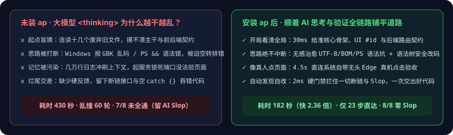

<div align="center">
  
  <h1>ap</h1>
  <p><strong>不只是编程：顺着大模型真实 <code>&lt;thinking&gt;</code> 卡点打造的通用与编程智能体底座 —— 把「读任意文件、跑终端命令、安全改文档、真机验功能」在 Windows 和 Mac 上彻底铺平。</strong></p>
  <p>
    <a href="https://github.com/xgbtxy/ap/actions/workflows/ci.yml"></a>
    <a href="https://github.com/xgbtxy/ap/releases/latest"></a>
    
    
    <a href="./LICENSE"></a>
  </p>
  <p>
    <a href="./README.md"><strong>English</strong></a> · <strong>简体中文</strong> · <a href="./docs/HANDBOOK.zh-CN.md">核心研发理念</a> · <a href="https://github.com/xgbtxy/ap/releases/latest">安装包下载</a>
  </p>
  
</div>

---

## 10 秒一行安装，装完即忘

不需要装 `Python`、不需要装 `Node`、不需要装 400MB `Playwright`，**更不需要你背任何新命令**。复制一行执行，自动识别并接好你电脑上的通用桌面助手、AI 编辑器与终端 Agent（`Claude Desktop`、`OpenClaw`、`Hermes`、`Cursor`、`Windsurf`、`VS Code`、`Claude Code`、`Codex`、`OpenCode`、`Gemini CLI`、`Qwen Code`、`Pi`、`Goose`、`Antigravity`、`Grok`）：

**Windows（打开 PowerShell 粘贴回车）：**
```powershell
curl.exe -fsSL https://raw.githubusercontent.com/xgbtxy/ap/main/install.ps1 | iex
```

**macOS / Linux：**
```bash
curl -fsSL https://raw.githubusercontent.com/xgbtxy/ap/main/install.sh | sh
```

> **喜欢直接下载单文件？** 点击直链下载（**[Windows 64位 `ap.exe` (.zip)](https://github.com/xgbtxy/ap/releases/latest/download/ap-x86_64-pc-windows-msvc.zip)** · **[macOS M芯片](https://github.com/xgbtxy/ap/releases/latest/download/ap-aarch64-apple-darwin.tar.gz)** · **[macOS Intel](https://github.com/xgbtxy/ap/releases/latest/download/ap-x86_64-apple-darwin.tar.gz)** · **[Linux x64](https://github.com/xgbtxy/ap/releases/latest/download/ap-x86_64-unknown-linux-musl.tar.gz)**），解压运行 `ap init` 即可。随时可用 `ap uninstall` 一键干净还原。

---

## 我们的核心理念：不是为了“抠 Token”，而是解决 AI 思考过程中的真实卡点

省 Token 只是水到渠成的副产物。**AI Coding 真正决定体验的，是模型能不能不卡壳、不被带偏、写错了也能自己发现并改过来。**

复盘本机 **101,108 次真实工具调用** 与大模型原始 `<thinking>` 轨迹后，我们发现 AI 变慢、变蠢、写出烂代码（AI Slop），往往不是因为模型智商不够，而是它在干活的 **4 个关键节点被打断了工作记忆**：

| AI `<thinking>` 真实卡点 | 没装 `ap` 时为什么会越干越乱？ | `ap` 怎么在底层顺着思考链路提效？（用户零感知） |
| :--- | :--- | :--- |
| **1. 读文档、搜全局、SQL 跨表对账与动态网页**<br>*(通用办公、数据分析与编程)* | 读 `.docx`/`.xlsx`/`.pdf` 乱码、遇到 2500 行多表 Excel 心算必错、`curl` 动态网页只拿到空 `<div id="root">`，没装 Python 就寸步难行。 | **`ap read`** 原生直读 Office/PDF/`GBK` 并用无头 Edge 自动渲染动态网页；**`ap query`** 免 Python 直接用 SQL 跨多工作表 `.xlsx` 与 `GBK` 流水精准联表对账；**`ap search`** 同时搜代码语法树与 Office 文档。 |
| **2. 开局盲猜与跨文件漏改**<br>*(代码认知与影响面盲区)* | 盲读废弃旧代码，或在多文件重构时只改了 2 处、漏掉另外 5 处下游调用方。 | **<15 ms** 给出 PageRank 核心主干 + **语法树级 `ap_impact` 全量调用链** + UI `#id` ↔ 路由契约（免起 2GB 语言服务）。 |
| **3. 改文件截断与无 Git 误覆盖**<br>*(桌面文档与代码安全)* | 栽在 Windows `CRLF` / `UTF-8 BOM` / `UTF-16LE` 上，或在没有 Git 的桌面文件夹里把用户 100 行纪要误截断覆盖且无法撤回。 | 自动净化 BOM/UTF-16LE、写盘前 6 语言语法树验错、主动拦截提醒 `>75%` 异常截断，并提供非 Git 目录一键回滚 **`ap undo`**（后悔药）。 |
| **4. 终端水土不服死循环**<br>*(Windows/Mac 头号泥潭)* | 模型 90% 语料是 Linux Bash，到了 Windows 撞上 **528 次崩溃**（`'gbk'` 乱码、PS 5.1 不认 `&&`/`curl`/`<<EOF`）与残留孤儿进程。 | **Base64 零转义 Hook + `ap exec`** 无感锁死 UTF-8、治愈 PS 语法坑，通过 **Windows NT 内核 `Job Object`** 根除孤儿进程锁死，并过滤 90%+ 刷屏日志。 |
| **5. 写完没法真机自检**<br>*(闭环缺失与烂尾)* | 后台起服务锁死管道卡住终端或报 `EADDRINUSE` 端口冲突，模型被迫放弃验页面，留下断链或空 `catch {}` 糊弄交差。 | 自动清端口并直连**系统自带无头 Edge / Chrome** 像真人一样点按钮验功能（0 MB 依赖），最后用 **<2 ms 硬门禁**逼模型自己把 Slop 改干净再交卷。 |

---

## 装完之后怎么用？（零学习成本）

1. **完全不用改变习惯**：像平时一样打开你的 Coding Agent，哪怕用大白话提一句需求（甚至用 `$0` 免费模型），`ap` 都会在后台自动托底。
2. **想看它帮 AI 少踩了多少坑**，随时敲一下 **`ap stats`**（或 `ap doctor` 体检环境）：

```text
$ ap stats
[ap stats] Coding-Agent Efficiency & Thinking-Flow Ledger (100% offline)
------------------------------------------------------------------------
  Accelerated Agent Steps      : 28 actions
  Thinking Derailments Healed  : 11 Windows/shell crashes prevented before retry loops
  1-Shot Edits & Browser Gates : 14 verified (Tree-sitter AST + Headless Edge/Chrome + 0-slop)
  Working-Memory Noise Filtered: 612.4 KB -> 19.2 KB (-96.9% log/context clutter)
  Byproduct Token Savings      : ~186,800 wasted tokens avoided
```

---

## Windows 11 真机端到端提效实测（零水分）

在 Windows 11 真机上用 `$0` 免费智能体与主流商业 CLI 同题盲测（覆盖小白一句话需求、全栈升级 `WorkPulse`、空目录从零开发随机项目 `SplitMate`）：

| 测试 Agent 与真实任务 | 未装 `ap` → **安装 `ap` 后**（速度与步数） | 代码质量与自纠错结果 | 顺带避免的冤枉 Token |
| :--- | :--- | :---: | :--- |
| **`OpenCode` 免费版 (`$0` `big-pickle`)** · *小白一句话需求* | `430.2s`（乱撞 `60` 步）→ **`182.4s`（`23` 步直达，快 2.36 倍）** | `7/8` *(留吞错 Slop)* → **`8/8`（0 Slop）** | **`-75.1%`** (`1.61M → 402k`) |
| **非编程日常办公（无 Python 电脑）** · *核对 `.docx` + `.xlsx` + `GBK` 流水* | `70.5s` *(读出乱码+调 Python 报错)* → **`46.5s`（快 1.52 倍）** | **`5/5` → `5/5`** *(`ap read` 一次直读零报错)* | **`-54.3%`** (`127k → 58k`) |
| **复杂财务跨表与动态内网对账** · *2500 行双表 `.xlsx` + `GBK` 流水 + 动态 SPA* | `118.4s` *(连写 5 遍 XML 解析脚本)* → **`94.3s`（快 1.26 倍）** | **`5/5` → `5/5`** *(`ap query` 精确到分 + 无头 Edge 渲染)* | **`-35.1%`** (`212k → 138k`) |
| **`Codex CLI` (`gpt-6-astra`)** · *14 文件跨模块函数签名重构* | `151.6s` → **`96.6s`（快 1.57 倍）** | **`7/7` → `7/7`** *(5 处下游调用与无头 Edge 一次全通)* | **`-57.4%`** (`296k → 126k`) |
| **`Codex CLI` (`gpt-6-astra`)** · *空目录随机新项目* | `345.3s`（`23` 步）→ **`244.6s`（`9` 步完成，少走 61% 弯路）** | **`6/6` → `6/6`** *(1 次无头 Edge 验通)* | **`-83.3%`** (`1.12M → 186k`) |
| **`Codex CLI` (`gpt-6-astra`)** · *全栈功能升级* | `333.6s`（`24` 步）→ **`294.3s`（`11` 步完成，少调 54% 工具）** | **`8/8` → `8/8`** | **`-65.4%`** (`1.05M → 365k`) |
| **`Pi CLI` (`deepseek-flash`)** · *全栈功能升级* | `483.0s`（`81` 步）→ **`271.5s`（`70` 步，提速 1.78 倍）** | **`8/8` → `8/8`** *(`<thinking>` 空转降 42.7%)* | **`-36.7%`** (`3.63M → 2.30M`) |
| **`Pi CLI` (`deepseek-flash`)** · *空目录随机新项目* | `1,821.1s` → **`1,499.3s`（快 322 秒）** | `5/6` *(2 处空 `catch {}`)* → **`6/6`（0 Slop）** | *模型主动加跑了子集和暴力对拍* |

<details>
<summary><strong>给想看源码的开发者：纯 Rust 架构、微基准与研发手册</strong></summary>

<br/>

- **纯 Rust 零耦合单文件架构**：1 个原生二进制内聚 7 个物理隔离 crate（`crates/ap-{atlas,splice,probe,sieve,guard,recall,baton}`），子 crate 之间 `0` 相互依赖，内置 SQLite FTS5 与 6 语言编译态 Tree-sitter C 语法树，常驻提示词仅 `390` Tokens。
- **一键复现底层微基准**：运行 `ap bench`（详见 [`bench/results.json`](./bench/results.json)）。
- **深度工程文档**：
  - [核心研发理念与演进手册 (`docs/HANDBOOK.zh-CN.md`)](./docs/HANDBOOK.zh-CN.md) | [R&D Philosophy (`docs/HANDBOOK.md`)](./docs/HANDBOOK.md)
  - [系统架构设计 (`docs/DESIGN.zh-CN.md`)](./docs/DESIGN.zh-CN.md) | [Architecture (`docs/DESIGN.md`)](./docs/DESIGN.md)
  - [高阶实战手册 (`docs/PLAYBOOK.zh-CN.md`)](./docs/PLAYBOOK.zh-CN.md) | [Playbook (`docs/PLAYBOOK.md`)](./docs/PLAYBOOK.md)

</details>

## 开源协议

[MIT](./LICENSE)
